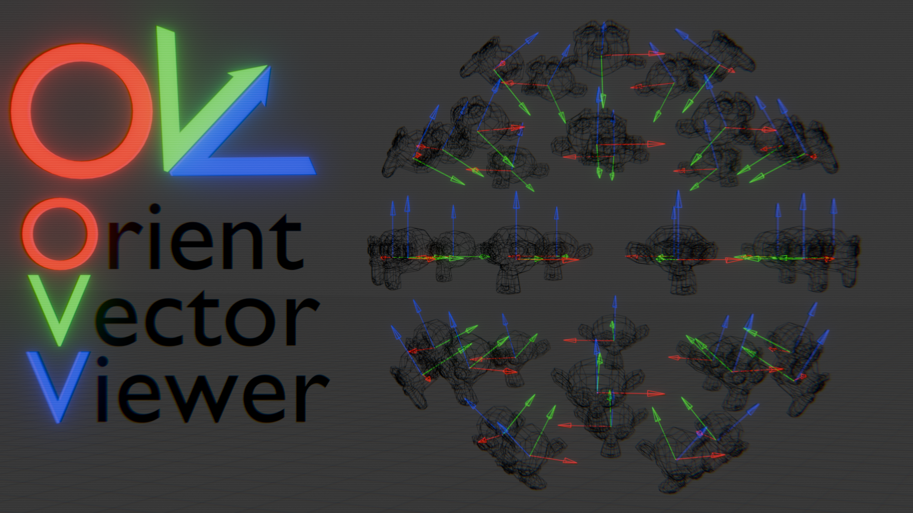

# OVV - Orient Vector View

OVV is designed to act as an extension of the viewer in geo nodes, allowing you to quickly visualize vectors and orientations.

## Main Goals
1. Quick, easy visualization
2. Support for multiple ways of defining orientations (Single Vector, Two Vector, Rotation, Quaternion, Matrix) 
3. Fully customizable user defaults for the node
4. Auto switching of visualization types (that you can manually override)

In designing this tool I wanted a collection of quaternion and matrix math nodes, they have been included as well. 

Besides reading this doc, the easiest way to learn the tool is to just try it out! A demo file has been included with the plugin and can be accessed by going to the add-on preferences and clicking "Open Demo Scene."

## The Orient Vector Viewer (OVV) Node:
To get started select a node with a geometry output and hit 'V'. That will create the `ovv_orient_vector_vis` node and a viewer, then wire it up to the geometry. You can also create the node through the standard Add Node (Shift-A) menu. It can be found under "Orient Vector Viewer -> OVV."  

The node is split into 3 main sections: Input Geometry, Visualization Geo, and Orientation. All parameter defaults can be set in the the Add-On preferences.

### Input Geometry
1. Geometry - Points to instance on
2. Sample Geo - Which domain to sample over, points or faces
3. Hide Base Geo - Whether to include Base Geo in the output of this node

### Visualization Geometry
1. Visualization Geo - Settings for the visualization output
2. Enable Lines Only - Show only a line rather than an arrow
3. Visualization Type - What type of visualization to use: Vectors, Basis, or Cube
4. Wireframe - Visualize as wireframe
5. Normalize - Normalize scale
6. Scale - Scale of visualization geo
7. Arrow Radius - Radius of the bottom circle of the cone
8. Arrow Depth - Height of the generated cone
9. Vector Color - Color to use for visualization geo vector
10. X - Color to use for X vector of basis
11. Y - Color to use for Y vector of basis
12. Z - Color to use for Z vector of basis
13. Use Color From Attribute - Whether to use the "Attribute for Color" to colorize vectors
14. Include Inverse Colors - Uses inverse colors for negative vector values (i.e. {0,-1,0} = Magenta)
15. Attribute for Color - Input attribute for color

### Orientation
1. Orientation - Settings to determine orientation of visualization geo
2. Orient Method
    - Auto Define from Input
        Orientation will be determined by the tool based on plugged in inputs. Inputs are prioritized from the bottom up, so if both a matrix and a quaternion are plugged in, the matrix will be used.
    - Single Vector
        Use the "Vector" socket to define a vector to visualize.
    - Two Vector
        "Vector" and "Up" socket will be used to define orientation. Vector represents the X and Up the Z.
    - Rotation
        Use a given rotation to define orientation.
    - Quaternion
        Use a given quaternion to define orientation.
    - Matrix
        Use a given matrix to define orientation.

3. Vector - Input vector used for "Single Vector" and "Two Vector" orientation modes
4. Up - When "Vector" and "Up" are both plugged in, used as the "Up" vector for the orientation
5. Rotation - Rotation used for orientation
6. Quat - Quaternion to use for orientation. This expects a bundle defined by the W,X,Y,Z inputs
7. Matrix - Matrix to be used for orientation
